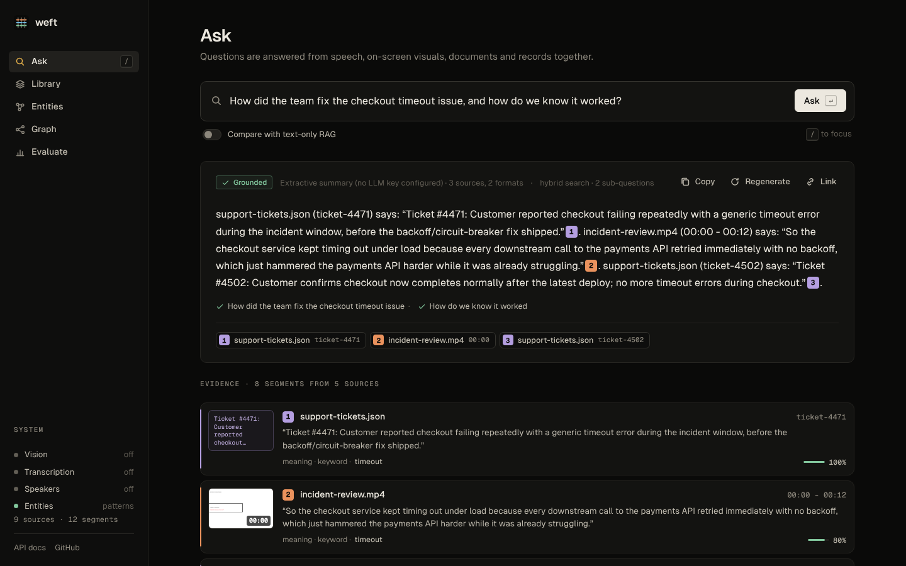
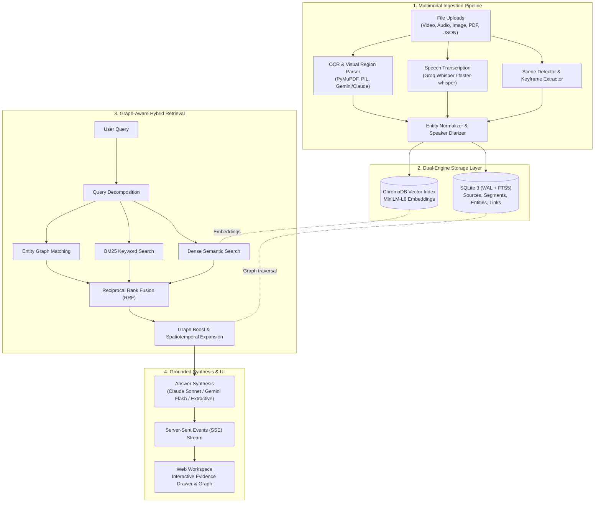
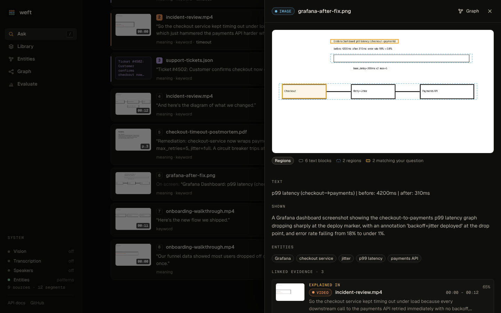
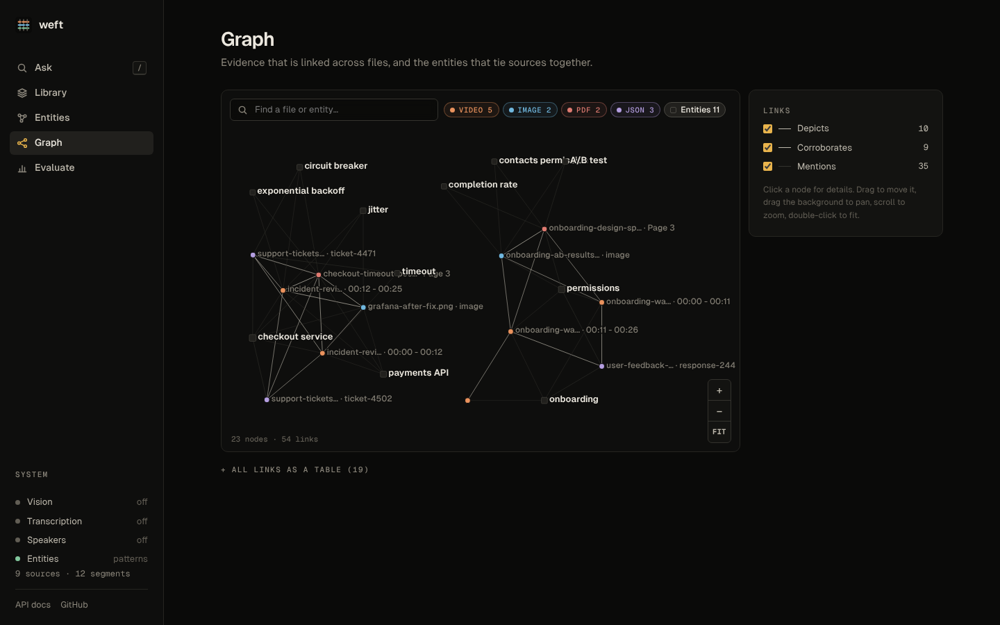
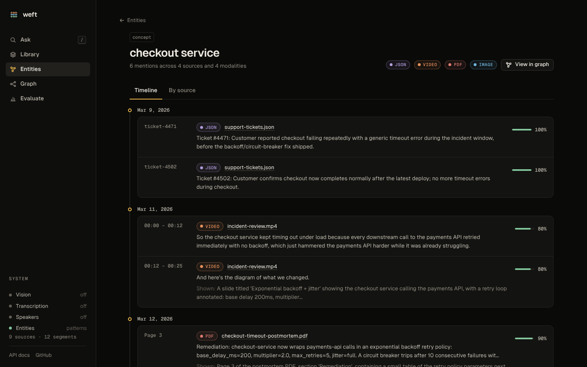
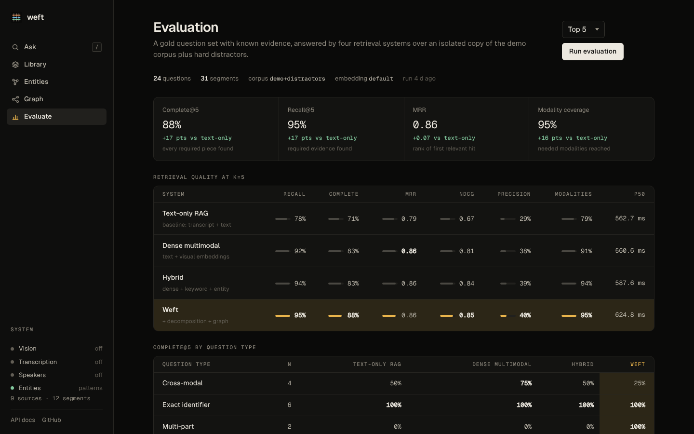

<div align="center">


# Ceft
### Multimodal Data Pipeline for Provenance-Aware Retrieval-Augmented Generation

[](https://github.com/Yug-dev0/CEFT/actions/workflows/ci.yml)
[](https://github.com/Yug-dev0/CEFT/actions/workflows/docker-publish.yml)
[](https://github.com/Yug-dev0/CEFT/actions/workflows/codeql.yml)
[](https://github.com/Yug-dev0)
[](LICENSE)
[](https://www.python.org/)
[](https://fastapi.tiangolo.com)
[](https://www.sqlite.org/)
[](https://www.trychroma.com/)
[](https://www.docker.com/)
[](tests)

<p align="center">
  <a href="#why-ceft">Why Ceft</a> •
  <a href="#key-features">Key Features</a> •
  <a href="#architecture">Architecture</a> •
  <a href="#benchmarks--evaluation">Benchmarks</a> •
  <a href="#ui-showcase">UI Showcase</a> •
  <a href="#quickstart">Quickstart</a> •
  <a href="#api-reference">API Reference</a> •
  <a href="#configuration">Configuration</a> •
  <a href="#author--community">Author</a>
</p>

[Product Guide](docs/PRODUCT.md) · [Requirements (PRD)](docs/PRD.md) · [Technical Spec](docs/TECHNICAL.md) · [Design System](docs/DESIGN.md) · [Evaluation Report](EVALUATION.md)

---



</div>

## Overview

**Ceft** is an end-to-end, multimodal knowledge pipeline designed for production RAG systems. It ingests video, audio, image, PDF, and structured JSON data, segments them into spatiotemporally grounded evidence units, links cross-file corroborations via an entity and relationship graph, and synthesizes answers with **verifiable, byte-exact citations** back to the exact second, frame region, or document page.

Unlike traditional text-centric RAG pipelines that flatten rich documents into lossy transcript text, **Ceft preserves the complete spatial and temporal context of every modality**:
- Video keyframes and speaker-attributed transcripts are preserved with millisecond timestamps.
- Screenshots and architectural diagrams retain OCR bounding boxes and visual semantic regions.
- Multi-page PDFs maintain exact page layout and dual-layer extracted text.
- Cross-modal edges (`depicts`, `corroborates`, `co_occurs`, `shows_same`, `same_as`) connect concepts across disparate file formats.

---

## Why Ceft?

| Challenge in Conventional RAG | How Ceft Solves It |
|---|---|
| **Loss of Visual Context** — Video slides, dashboards, and charts are lost when only audio transcripts or text layers are processed. | **Visual Keyframe Extraction & Analysis** — OpenCV-based scene transition detection extracts visual frames, passing them through Gemini or Claude for visual entity and region extraction. |
| **Hallucinated or Vague Citations** — Answers cite entire files or huge chunks without pinpoint provenance. | **Exact Spatiotemporal Locators** — Every citation points to an exact `[t_start, t_end]` video timestamp, page number, or normalized bounding box `[x1, y1, x2, y2]`. |
| **Fragmented Multi-Part Questions** — Complex queries covering multiple sub-topics fail in simple vector similarity lookups. | **Query Decomposition & Fusion** — Decomposes complex queries into sub-questions, executing dense + BM25 keyword + entity search, fused via Reciprocal Rank Fusion (RRF). |
| **Disconnected Information Silos** — A ticket in JSON, a meeting in MP4, a chart in PNG, and a report in PDF remain isolated. | **Cross-Modal Knowledge Graph** — Automatically creates typed semantic edges linking entities, spoken words, and visual elements across different files. |

---

## Key Features

### 1. Ingestion & Multimodal Extractors
- **Adaptive Scene-Cut Video Processing**: Uses pixel-level delta thresholding to segment videos into coherent visual scenes (not arbitrary time slices). Aligns Whisper audio transcripts to video scenes and locates on-screen text regions.
- **High-Fidelity Audio Diarization**: Transcribes speech via Groq Whisper (with local `faster-whisper` fallback) with timestamped confidence scores and Gemini speaker attribution.
- **Dual-Layer PDF Extraction**: Renders PDF pages with PyMuPDF while extracting exact digital text layers, capturing both visual diagram layout and raw textual content.
- **Spatial Image Inspection**: Detects OCR text blocks and outlines visual entities with normalized bounding boxes (`[ymin, xmin, ymax, xmax]`).
- **Resilient Background Processing**: Asynchronous ingestion workers with progress tracking, persistent job resumption, and content-hash deduplication (`SHA-256`).

### 2. Graph-Aware Knowledge Model
- **Structured SQLite System of Record**: ACID-compliant relational storage for sources, segments, locators, entities, and typed relationships, backed by WAL mode and FTS5 full-text indexing.
- **ChromaDB Vector Store**: Fast vector similarity search over multimodal semantic embeddings (MiniLM-L6).
- **Typed Entity Registry**: Normalizes aliases and variants (e.g., "Checkout Service", "checkout-svc", "svc-checkout") into unified entity nodes with cross-modal timelines.
- **Cross-Modal Semantic Linker**: Automatically generates links:
  - `depicts`: Visual evidence portraying an entity or concept.
  - `corroborates`: Independent sources confirming the same finding.
  - `co_occurs`: Multimodal events occurring in the same temporal window.
  - `shows_same`: Identical visual artifacts or metrics appearing in multiple files.

### 3. Multi-Stage Hybrid Retrieval & Answer Synthesis
- **Query Decomposition**: Splits multi-intent prompts into targeted sub-queries to guarantee coverage across disparate modalities.
- **Hybrid Rank Fusion (RRF)**: Combines dense vector similarity, BM25 keyword matching (for exact identifiers like `timeout=30s`), and entity graph matching.
- **Cross-Modal Graph Expansion**: Boosts relevant evidence found in neighboring graph nodes across different formats.
- **Streaming Citation Generation**: Streams LLM synthesis (via Claude 3.5 Sonnet or Gemini 1.5/2.0 Flash) using Server-Sent Events (SSE), inserting numbered citations that trigger interactive evidence drawers.

---

## Architecture



---

## Benchmarks & Evaluation

Ceft includes a built-in evaluation harness with a **gold benchmark dataset** of 24 multi-part questions evaluated against a multi-modal incident corpus (containing videos, diagrams, PDF incident reports, Grafana screenshots, and JSON logs with hard distractors).

### System Comparison (Top-5 Retrieval)

| Retrieval System | Recall@5 | Complete@5 | MRR | nDCG@5 | Modality Coverage |
|---|:---:|:---:|:---:|:---:|:---:|
| **Text-Only RAG (Baseline)** | 78% | 71% | 0.79 | 0.67 | 79% |
| **Dense Multimodal** (Text + Visuals) | 92% | 83% | 0.86 | 0.81 | 91% |
| **Hybrid** (Dense + BM25 + Entity) | 94% | 83% | 0.86 | 0.84 | 94% |
| **Ceft** (Hybrid + Decompose + Graph) | **95%** | **88%** | **0.86** | **0.85** | **95%** |

*Evaluation metrics defined:*
- **Recall@5**: Percentage of required ground-truth evidence pieces retrieved in the top 5.
- **Complete@5**: Percentage of queries where **all** necessary pieces of evidence across all required modalities were successfully retrieved.
- **MRR (Mean Reciprocal Rank)**: Reciprocal rank of the first relevant evidence item.
- **Modality Coverage**: Ratio of required modalities (audio, video, PDF, image, text) represented in the retrieved evidence.

---

## UI Showcase

| Interactive Evidence Drawer | Cross-Modal Knowledge Graph |
|---|---|
|  |  |
| *Pinpoints exact bounding boxes on screenshots and timestamped video offsets.* | *Visualizes relationships between services, metrics, people, and documents.* |

| Entity Timeline Across Modalities | Comprehensive Evaluation Suite |
|---|---|
|  |  |
| *Chronological timeline of entity mentions across JSON, meetings, and reports.* | *Ablation comparisons of retrieval strategies on the gold test suite.* |

---

## Quickstart

### Option 1: Docker (Recommended)

Run Ceft in an isolated container with all pre-configured dependencies:

```bash
# Clone the repository
git clone https://github.com/Yug-dev0/CEFT.git
cd CEFT

# Configure environment variables (optional: add API keys for live LLM streaming)
cp .env.example .env

# Start Ceft via Docker Compose
docker compose up --build
```

Access the web workspace at **[http://localhost:8000/app](http://localhost:8000/app)**.

### Option 2: Local Python Environment

**Prerequisites:** Python 3.10+ and `ffmpeg` (for video and audio processing).

```bash
# Clone the repository
git clone https://github.com/Yug-dev0/CEFT.git
cd CEFT

# Create and activate virtual environment
python3 -m venv .venv
source .venv/bin/activate       # On Windows: .\.venv\Scripts\Activate.ps1

# Install requirements
pip install -r requirements.txt
pip install -r requirements-dev.txt

# Create .env config
cp .env.example .env

# Run FastAPI with Uvicorn
uvicorn main:app --reload --host 0.0.0.0 --port 8000
```

Open **[http://127.0.0.1:8000/app](http://127.0.0.1:8000/app)** in your browser.

### Option 3: Seeding Sample Demo Data

To immediately explore the knowledge graph without uploading personal files:
1. Navigate to `http://localhost:8000/app`
2. Click **Load sample data** or trigger the API directly:
```bash
curl -X POST http://127.0.0.1:8000/demo/seed
```
3. Ask: *"How did the team fix the checkout timeout issue, and how do we know it worked?"*

---

## Workflows & CI/CD

Ceft features enterprise-grade GitHub Actions workflows ensuring strict quality, reliability, and security:

| Workflow | File | Trigger | Purpose |
|---|---|---|---|
| **CI** | [`.github/workflows/ci.yml`](.github/workflows/ci.yml) | Push & PR | Runs test matrix across Python 3.10, 3.11, and 3.12, enforces Ruff linting, runs Pytest with coverage, and executes end-to-end Docker container smoke tests. |
| **Docker Publish** | [`.github/workflows/docker-publish.yml`](.github/workflows/docker-publish.yml) | Push to `main` & Tags | Builds and pushes multi-platform OCI containers to GitHub Container Registry (`ghcr.io/yugpatel-09/ceft`). |
| **CodeQL SAST** | [`.github/workflows/codeql.yml`](.github/workflows/codeql.yml) | Push, PR & Cron | Automated static application security scanning for Python and JavaScript code vulnerabilities. |
| **Release Drafter** | [`.github/workflows/release.yml`](.github/workflows/release.yml) | Push Tag `v*.*.*` | Automatically generates GitHub Releases with changelogs and release notes. |
| **Dependency Review** | [`.github/workflows/dependency-review.yml`](.github/workflows/dependency-review.yml) | Pull Request | Scans PR dependencies for known CVEs, malicious packages, and license compatibility. |

---

## API Reference

Interactive Swagger documentation is available at **`/docs`** (and ReDoc at **`/redoc`**).

### 1. Ingestion Endpoints

Upload files for background or synchronous processing:

```bash
# Upload a meeting recording or presentation
curl -F "file=@meeting.mp4" "http://127.0.0.1:8000/upload/video?background=true"

# Upload an audio memo or podcast
curl -F "file=@interview.mp3" "http://127.0.0.1:8000/upload/audio?background=true"

# Upload an incident report or documentation PDF
curl -F "file=@postmortem.pdf" "http://127.0.0.1:8000/upload/pdf"

# Upload a dashboard or diagram screenshot
curl -F "file=@metrics_grafana.png" "http://127.0.0.1:8000/upload/image"

# Upload structured JSON records
curl -F "file=@jira_tickets.json" "http://127.0.0.1:8000/upload/json"
```

### 2. Query & Retrieval Endpoints

```bash
# Standard synchronous query
curl -X POST http://127.0.0.1:8000/query \
     -H "Content-Type: application/json" \
     -d '{
       "query": "What retry policy replaced the old one, and where was it shown?",
       "limit": 5
     }'

# Real-time streaming query over Server-Sent Events (SSE)
curl -N -X POST http://127.0.0.1:8000/query/stream \
     -H "Content-Type: application/json" \
     -d '{"query": "Summarize the root cause from the postmortem", "limit": 5}'

# Compare Ceft against baseline text-only RAG
curl -X POST http://127.0.0.1:8000/query/compare \
     -H "Content-Type: application/json" \
     -d '{"query": "Show latency before and after the fix", "limit": 5}'

# Export complete investigation dossier (Markdown or HTML)
curl -X POST http://127.0.0.1:8000/query/dossier \
     -H "Content-Type: application/json" \
     -d '{"query": "How was checkout timeout resolved?", "format": "markdown"}'

# Multi-turn conversation with query reformulation
curl -X POST http://127.0.0.1:8000/query/chat \
     -H "Content-Type: application/json" \
     -d '{"query": "Who approved the backoff change?", "session_id": "incident-postmortem-1"}'
```

### 3. Knowledge Graph & Metadata Endpoints

```bash
# Retrieve unified chronological incident timeline across all sources
curl "http://127.0.0.1:8000/knowledge/timeline?limit=50"

```bash
# Retrieve knowledge repository statistics
curl http://127.0.0.1:8000/stats

# Get complete or filtered knowledge graph
curl "http://127.0.0.1:8000/graph?limit=100"

# Query entity timeline across all modalities
curl "http://127.0.0.1:8000/entities/ent_checkout_service/timeline"

# Inspect background ingestion job status
curl "http://127.0.0.1:8000/jobs?status=completed"
```

---

## CLI Tools

Ceft provides native command-line utilities for administration and evaluation:

```bash
# Run evaluation benchmark and generate markdown report
python -m app.evaluation run --k 5 --markdown EVALUATION.md

# Inspect repository statistics (sources, segments, entities, relations)
python -m app.cli stats

# Rebuild the ChromaDB vector index from the SQLite system of record
python -m app.cli reindex

# Recompute cross-modal entity and semantic links
python -m app.cli relink

# Run Model Context Protocol (MCP) stdio server for Claude Desktop / Cursor
python -m app.cli mcp
```

### Model Context Protocol (MCP) Server

Ceft includes a native MCP server exposing multimodal RAG tools over JSON-RPC 2.0 stdio transport:
- `ceft_search`: Hybrid dense + keyword + entity retrieval with exact locators and timestamps.
- `ceft_ask`: Synthesized answers with byte-exact citations.
- `ceft_get_evidence`: Inspect specific evidence segment with bounding boxes and relations.
- `ceft_get_entity`: Entity lookup with aliases and cross-modal timeline.
- `ceft_list_sources`: List all indexed files and modalities.
- `ceft_get_timeline`: Chronological event sequence across all sources.

Add to `claude_desktop_config.json`:
```json
{
  "mcpServers": {
    "ceft": {
      "command": "python3",
      "args": ["-m", "app.mcp"],
      "cwd": "/path/to/ceft"
    }
  }
}
```

---

## Configuration

Settings are configured via environment variables or a `.env` file:

| Environment Variable | Default | Description |
|---|---|---|
| `LLM_PROVIDER` | `auto` | Model provider: `claude`, `gemini`, or `auto` (prefers Claude if `ANTHROPIC_API_KEY` is set, else Gemini). |
| `ANTHROPIC_API_KEY` | *(None)* | Anthropic API key for Claude 3.5 Sonnet visual understanding and answer synthesis. |
| `GEMINI_API_KEY` | *(None)* | Google Gemini API key for multimodal vision, speaker attribution, and answer synthesis. |
| `CLAUDE_MODEL` | `claude-sonnet-5-5` | Specific Claude model variant to use. |
| `GEMINI_MODEL` | `gemini-3.6-flash` | Specific Gemini model variant to use. |
| `GROQ_API_KEY` | *(None)* | Groq API key for ultra-fast Whisper audio transcription. Uses local faster-whisper when unset. |
| `CEFT_API_KEY` | *(None)* | Optional authentication secret required for write operations (`POST`, `DELETE`). |
| `CORS_ORIGINS` | `""` | Comma-separated list of allowed origins. Empty allows same-origin only. |
| `MEDIA_STORAGE_ROOT` | `./data` | Directory for uploaded media files and extracted artifacts. |
| `KNOWLEDGE_DB_PATH` | `./data/knowledge.db` | Location of SQLite knowledge base database. |
| `CHROMA_PATH` | `./chroma_db` | Storage path for ChromaDB vector embeddings. |
| `SCENE_CUT_THRESHOLD` | `0.04` | Visual change threshold for triggering video scene cuts. |
| `MAX_UPLOAD_MB` | `500` | Maximum file upload size in megabytes. |
| `JOB_WORKERS` | `2` | Number of background workers for ingestion tasks. |
| `LOG_LEVEL` | `INFO` | Application log verbosity (`DEBUG`, `INFO`, `WARNING`, `ERROR`). |

---

## Project Structure

```
CEFT/
├── main.py                     # FastAPI application entrypoint & middleware
├── pyproject.toml              # Project metadata, tools & package configuration
├── Dockerfile                  # Production container definition
├── docker-compose.yml          # Container orchestration with volume persistence
├── app/
│   ├── api/                    # REST API routers & security middleware
│   │   ├── routes/             # Ingestion (video, audio, pdf, image, json), query, graph
│   │   └── security.py         # API key auth, security headers, rate-limiting & CSP
│   ├── db/                     # SQLite repository & schema management
│   │   └── repository.py       # CRUD operations, FTS5 queries, graph traversal
│   ├── evaluation/             # Evaluation harness, gold questions & metrics runner
│   │   ├── gold.py             # 24 benchmark questions & ground-truth evidence
│   │   └── runner.py           # Multi-system ablation runner
│   ├── schemas/                # Pydantic data models & typed entity definitions
│   └── services/               # Core processing engine
│       ├── answer_synthesizer.py # LLM synthesis with cited provenance
│       ├── audio_processor.py    # Whisper transcription & speaker alignment
│       ├── claude.py / gemini.py # Model integration adapters
│       ├── cross_modal_linker.py # Typed relation graph builder
│       ├── image_processor.py    # OCR and visual bounding box extractor
│       ├── pdf_processor.py      # Dual-layer PDF parser
│       ├── retrieval.py          # Hybrid fusion (BM25 + Dense + Entity)
│       ├── scene_detector.py     # Video cut detector
│       └── vector_store.py       # ChromaDB embedding indexing
├── static/                     # Embedded web UI (HTML, CSS, ES modules, self-hosted fonts)
├── test_data/                  # Bundled sample incident dataset
├── tests/                      # 119+ unit and integration tests
└── docs/                       # Architectural specifications & documentation
```

---

## Security

- **Authentication**: When `CEFT_API_KEY` is configured, all mutation and inference endpoints (`POST`, `DELETE`, `/query`) require authentication via `X-API-Key` or `Authorization: Bearer`.
- **Strict Content Security Policy (CSP)**: Built-in headers prevent XSS, clickjacking, and unauthorized resource embedding.
- **Zero Third-Party CDN Calls**: All fonts, icons, and UI assets are self-hosted with zero external tracking.
- **Input Validation & Magic Byte Inspection**: Strict file signature verification prevents arbitrary file upload vulnerabilities.
- For vulnerability disclosures, please review [SECURITY.md](SECURITY.md).

---

## Contributing

Contributions are warmly welcomed! Please read our [CONTRIBUTING.md](CONTRIBUTING.md) guide for details on development workflows, coding conventions, and submitting pull requests.

---

## Citation

If you use **Ceft** in your research, academic work, or production engineering, please cite:

```bibtex
@software{patel2026ceft,
  author = {Patel, Yug},
  title = {Ceft: Multimodal Data Pipeline for Provenance-Aware Retrieval-Augmented Generation},
  url = {https://github.com/Yug-dev0/CEFT},
  year = {2026},
  version = {0.3.0}
}
```

---

## Author & Community

- **Author**: Yug Patel
- **GitHub**: [@Yug-dev0](https://github.com/Yug-dev0)
- **Repository**: [https://github.com/Yug-dev0/CEFT](https://github.com/Yug-dev0/CEFT)
- **Email**: [yug.dev04@gmail.com](mailto:yug.dev04@gmail.com)

---

## License

This project is licensed under the **MIT License** — see the [LICENSE](LICENSE) file for complete details.
